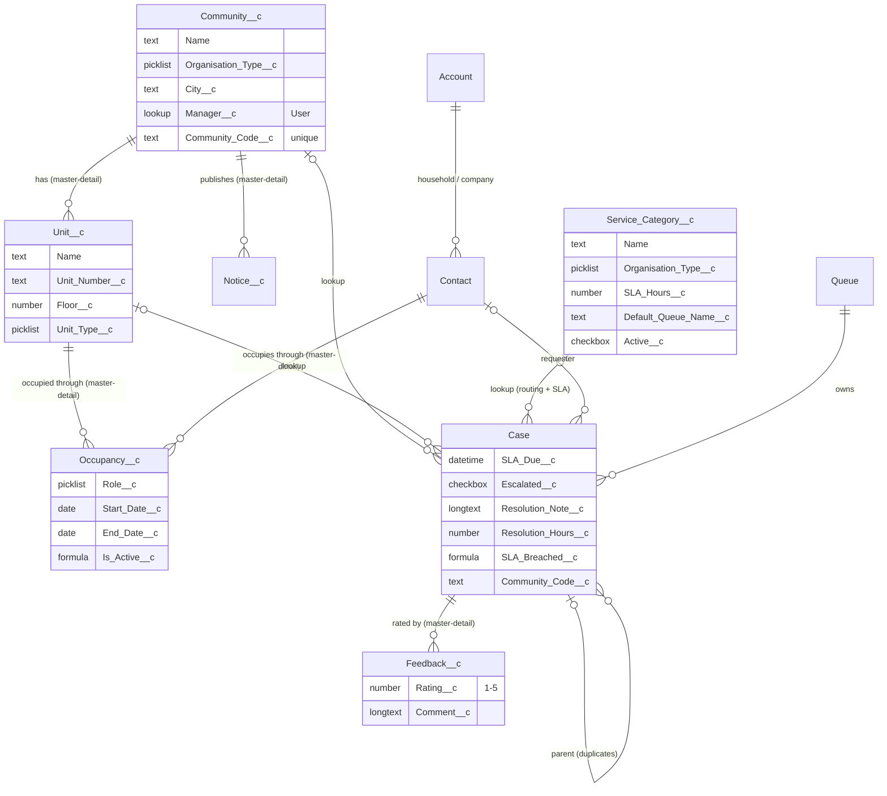
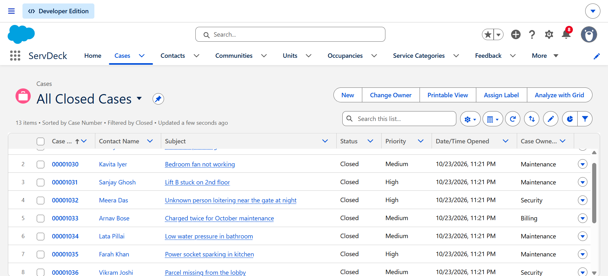
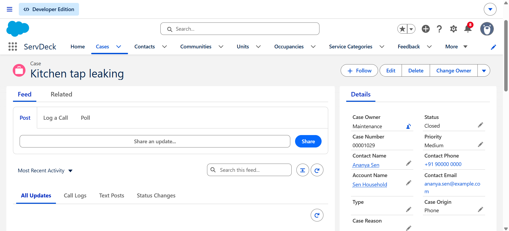
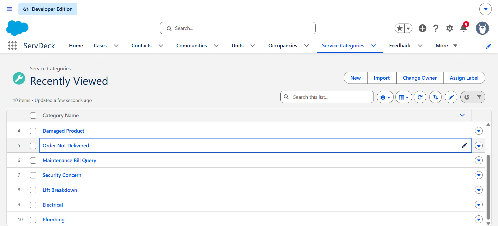
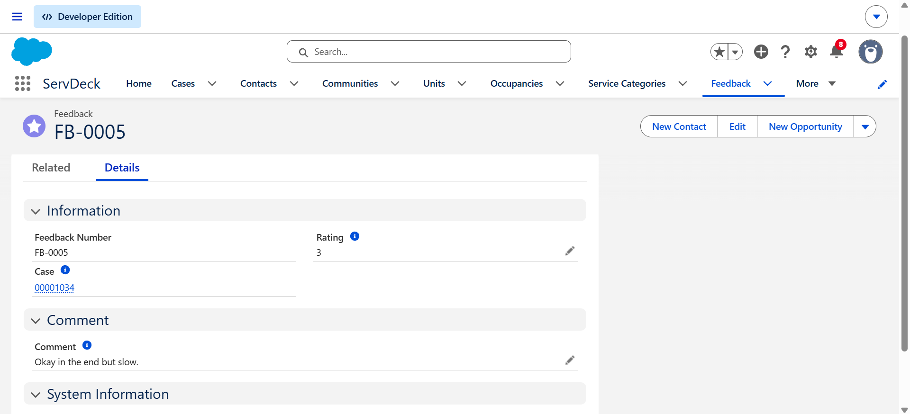
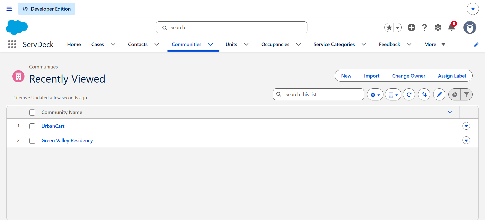
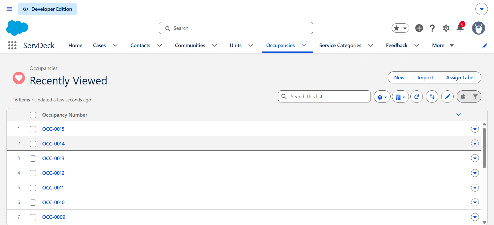
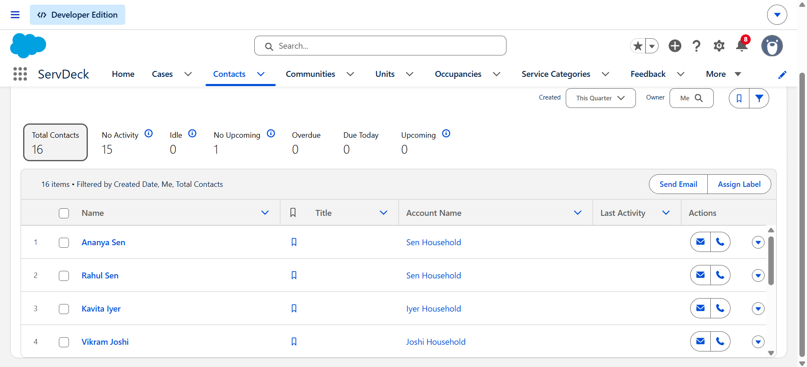

# ServDeck

A configurable service desk built on Salesforce for any organisation that serves a group of
people: a housing society, a hostel or campus, a co-working space, or a business handling customer
complaints.

Requests come in through a web form (or are logged by staff), are **routed to the right team** by
service category, get an **SLA deadline**, are **escalated automatically** when they run late, and
the requester is **asked for a rating** when the case closes. Managers watch a dashboard; staff see a
**360° view** of any flat, shop or customer. One data model runs a housing society and a retail
support desk side by side: the difference is just the community's **Organisation Type** and its
categories.

**Demo flow (2 minutes):** web request → auto-routed to a queue with an SLA → escalated when overdue →
resolved → feedback requested → dashboard.

_TODO: link to the demo video._

## Design choices

| Decision                                                                       | Why                                                                                                                                                                                                                                                             |
| ------------------------------------------------------------------------------ | --------------------------------------------------------------------------------------------------------------------------------------------------------------------------------------------------------------------------------------------------------------- |
| **Standard Case, Contact, Account, Queue** instead of a custom "Ticket" object | Case already has status, priority, origin, queues, Web-to-Case, case comments and reporting. Rebuilding that would throw away platform features.                                                                                                                |
| **Flow for automation, Apex only for the duplicate guard**                     | Routing, SLA, acknowledgement, escalation and feedback are all declarative and easy for an admin to change. Duplicate detection needs set-based logic across the whole batch, which is clearer and safer in Apex.                                               |
| **One before-save flow for field updates**                                     | Before-save flows change the record without an extra DML statement, which is the fastest way to set owner, SLA and resolution time.                                                                                                                             |
| **Scheduled path at `SLA_Due__c` for escalation**                              | Scheduled flows can only run daily or weekly. A scheduled path fires per case at exactly its deadline, reschedules if the deadline changes, and is cancelled if the case closes first.                                                                          |
| **Emails on asynchronous paths, via email alerts**                             | A mail problem can never roll back the case. Email alerts use the large workflow email allowance, not the 15-a-day single-email limit of a Developer Edition org.                                                                                               |
| **Duplicate guard: block for staff, link for web/email**                       | Staff see the error and can comment on the existing case. Web requesters never see errors, so their duplicate is attached as a child case instead of being silently lost.                                                                                       |
| **Web cases routed by an assignment rule that reads the flow's result**        | Web-to-Case always applies the active assignment rule after flows (and without one, resets the owner to the default). The flow resolves the category from the form, then a rule with one entry per queue routes on `Service_Category__r.Default_Queue_Name__c`. |
| **Duplicate query runs `WITH SYSTEM_MODE`**                                    | Apex at API 67 enforces the running user's permissions by default. The guard must see every open case and the ServDeck fields even when the Automated Case User or an agent cannot.                                                                             |
| **Case is Private; access through queues and sharing rules**                   | Agents see only their queues' cases. Managers get their community's cases through criteria-based sharing rules.                                                                                                                                                 |
| **Permission sets, not profile edits**                                         | Agent, Manager and Admin access is granted with permission sets on top of the Standard User profile, so access can be combined and audited.                                                                                                                     |

## Data model



- **Occupancy** is a junction object: a flat has many residents and a person can own several flats.
  It keeps history (an ended tenancy stays on record with an End Date).
- **Case → Community/Unit are lookups, not master-detail.** A standard object cannot be the detail of
  a custom object, and a detail record has no owner of its own, while queue routing works by setting
  the Case owner.
- **Organisation Type** is a global value set shared by Community and Service Category, and a
  validation rule stops a retail category being used on a housing-society case.

## Features

| #   | Feature             | Built with                                          | How it works                                                                                                                                                                                                                                                                   |
| --- | ------------------- | --------------------------------------------------- | ------------------------------------------------------------------------------------------------------------------------------------------------------------------------------------------------------------------------------------------------------------------------------ |
| 1   | Data model + app    | Custom objects, layouts, Lightning app              | "ServDeck" app with tabs for cases, contacts, communities, units, occupancies, categories, feedback, notices, reports and dashboards.                                                                                                                                          |
| 2   | Two demo setups     | `sf data import tree`                               | Green Valley Residency (housing society, Kolkata) and UrbanCart (retail, Bengaluru): 15 households/customers, 14 units, 10 categories, 30 cases, 12 ratings.                                                                                                                   |
| 3   | Validation          | 6 validation rules                                  | Resolution note required to close; unit must belong to the case's community; category must match the community's organisation type; rating 1-5; occupancy cannot end before it starts; SLA hours > 0.                                                                          |
| 4   | Routing + SLA       | Record-triggered flow (before save)                 | New case with a category → owner = the category's queue, `SLA_Due__c` = now + SLA hours. Also links the requester by email and copies the community code used by sharing rules.                                                                                                |
| 5   | Acknowledgement     | Record-triggered flow (async path) + email template | The requester gets the case number and expected resolution time.                                                                                                                                                                                                               |
| 6   | Escalation          | Record-triggered flow with a scheduled path         | At `SLA_Due__c`, an open case gets `Escalated__c = true`, Priority High, and the community manager gets a bell notification. Never escalated twice.                                                                                                                            |
| 7   | Duplicate guard     | Apex trigger + handler                              | Same unit + category as an open case from the last 24 h: blocked with the existing case number for staff; linked as a child case for Web/Email. One query per batch; tested with 200 records.                                                                                  |
| 8   | Feedback            | Record-triggered flow (async path) + email template | On close, the requester is emailed the resolution and asked for a 1-5 rating, recorded as Feedback on the case.                                                                                                                                                                |
| 9   | Unit 360            | Lightning Web Component + Apex                      | On Unit and Contact pages: current occupants (or the person's units), last 10 cases, open count, average resolution hours and average rating, with loading, empty and error states.                                                                                            |
| 10  | Security            | Permission sets, OWD, queues, sharing rules         | Agents see only their queues' cases; managers see everything in their community; admins see all.                                                                                                                                                                               |
| 11  | Intake              | Web-to-Case + assignment rule                       | A generated web form per community sends the request. Web-to-Case can't fill lookups, so the form sends text and the flow turns it into community, unit and category lookups and links the contact by email; the assignment rule then routes the case to the category's queue. |
| 12  | Reports + dashboard | 5 reports, 1 dynamic dashboard                      | Open cases by community and category, SLA breach %, average resolution time, CSAT average and weekly trend. The dashboard runs as the viewer, so each person sees only their own data.                                                                                         |

## Security model

|                                                                | Agent (Arjun Mehta)                                      | Manager (Neha Kapoor)                                | Admin            |
| -------------------------------------------------------------- | -------------------------------------------------------- | ---------------------------------------------------- | ---------------- |
| Cases                                                          | Only cases owned by their queues (Maintenance, Security) | All cases of their community, any queue              | All              |
| Communities, units, categories                                 | Read                                                     | Edit their community, units, occupancies and notices | Full             |
| Automation-owned fields (SLA Due, Escalated, Resolution Hours) | Read only                                                | Read only                                            | Edit             |
| Granted by                                                     | `ServDeck_Agent` + queue membership                      | `ServDeck_Manager` + community group (sharing rule)  | `ServDeck_Admin` |

Org-wide defaults: Case **Private**, Contact **Read**, Community **Read**, and Unit, Occupancy,
Feedback and Notice **Controlled by Parent**. Contacts belong to a household or customer Account,
because a contact without an account is private to its owner whatever the default says.

## Deploy to your own org

Prerequisites: [Salesforce CLI](https://developer.salesforce.com/tools/salesforcecli), Node.js 18+,
and a free [Developer Edition org](https://developer.salesforce.com/signup).

```powershell
git clone <this repo>
cd ServDeck
npm install

# 1. Connect the org
sf org login web --alias sd --set-default

# 2. Deploy all metadata and run the Apex tests
sf project deploy start --source-dir force-app --test-level RunLocalTests

# 3. Give yourself admin access, then create the demo agent and manager
sf org assign permset --name ServDeck_Admin
sf apex run --file scripts/apex/create-demo-users.apex

# 4. Load the sample data and finish it (community managers, a web duplicate)
sf data import tree --plan data/sample-plan.json
sf apex run --file scripts/apex/sample-data-post-load.apex

# 5. Check that agents and managers see exactly what they should
sf apex run --file scripts/apex/verify-security.apex
```

### Web-to-Case (optional)

1. In Setup → **Support Settings**, note the **Automated Case User**, then run
   `sf org assign permset --name ServDeck_Web_Intake --on-behalf-of <that user's username>`.
2. Generate a form: `node scripts/web-to-case/generate-form.js GVR` (or `UCT`), then open
   `web-to-case/gvr-request-form.html` in a browser and submit a request.

### Notes

- If login fails with `OAUTH_APPROVAL_ERROR_GENERIC`, open Setup → **Connected Apps OAuth Usage**,
  click **Install** next to **Salesforce CLI**, and log in again.
- If the deploy reports that sharing is being recalculated, wait a minute and run it again (changing
  org-wide defaults starts a background recalculation).
- Set Setup → **Company Information → Default Time Zone** to your time zone so SLA times in emails
  are shown in local time.
- To try the app as the agent or manager: Setup → Users → **Login** next to the user.
- Email-to-Case is not configured: it needs a routing address whose verification email you can
  receive. Cases created by it would be linked to the contact and routed the same way.

## Tests

```powershell
sf apex run test --test-level RunLocalTests --code-coverage --result-format human --wait 10
npm run test:unit
```

| Suite                    | What it covers                                                                                                                                                                                                                                                                                                |
| ------------------------ | ------------------------------------------------------------------------------------------------------------------------------------------------------------------------------------------------------------------------------------------------------------------------------------------------------------- |
| `CaseTriggerHandlerTest` | Duplicate guard: single case, blocked duplicate with message, web/email linking, different unit or category, closed case, outside the 24 h window, duplicates within one insert, bulk 200 distinct, bulk 200 duplicates, and a Web-to-Case intake user without access to the lookup fields (regression test). |
| `CaseAutomationTest`     | Flows and validation rules through real DML: routing, SLA, preset SLA kept, unknown queue, community code, resolution hours, SLA breach, all validation rules, email flows don't block saves.                                                                                                                 |
| `Unit360ControllerTest`  | Unit and Contact summaries, averages, empty unit, 10-case limit, invalid input, access as an agent.                                                                                                                                                                                                           |
| `SecurityModelTest`      | Agents see only their queues' cases, users without a queue see none, agents can't edit reference data or automation-owned fields, agents can close their cases.                                                                                                                                               |
| `unit360.test.js` (Jest) | Loading, data, empty, Contact-page and error states of the component.                                                                                                                                                                                                                                         |

Criteria-based sharing rules are evaluated when a transaction commits, and Apex tests never commit,
so manager visibility is checked against real users by `scripts/apex/verify-security.apex`.

Latest run: 36 Apex tests passing, 97% org-wide coverage (CaseTriggerHandler 100%,
Unit360Controller 96%); 6 Jest tests passing.

## Project structure

```text
force-app/main/default/
  objects/            custom objects, Case/Contact fields, validation rules, sharing models
  flows/              Case - Before Save, After Create, After Close, Escalate Overdue
  classes/ triggers/  CaseTrigger, CaseTriggerHandler, Unit360Controller, tests, TestDataFactory
  lwc/unit360/        Unit 360 component and Jest tests
  permissionsets/     ServDeck Agent / Manager / Admin / Web Intake
  sharingRules/ groups/ queues/
  reports/ reportTypes/ dashboards/
  email/ workflows/   email templates and the email alerts flows send
data/                 sample data plan for sf data import tree
scripts/apex/         demo users, post-load, security verification
scripts/web-to-case/  web form generator
```

## Screenshots

**Closed cases, each owned by the queue its category routed it to**


**A case: routed to Maintenance, linked to the requester and their household**


**Service categories: each sets the queue and SLA hours**


**Feedback recorded after a case closes**


**Communities: a housing society and a retail business in one org**


**Occupancies: who lives in which flat**


**Residents and customers, grouped into households and companies**


_TODO: Unit 360 on a flat, escalated case with the bell notification, web form, dashboard._
